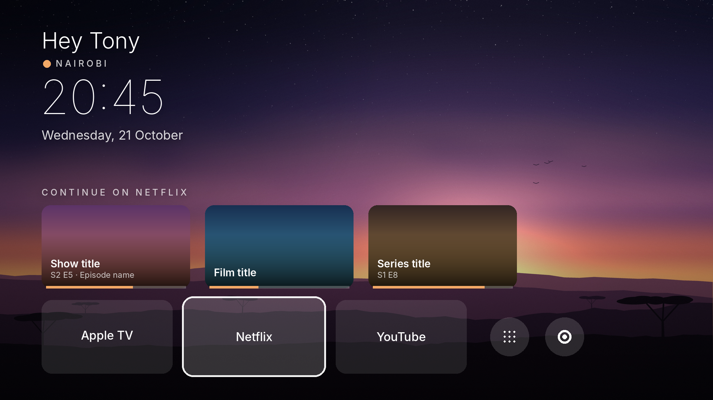

# Nyumbani: a calm home screen for Android TV

Nyumbani ("at home" in Swahili) replaces your TV's busy home screen with a quiet one: a
full-screen wallpaper, a frosted-glass greeting and clock, and a glass dock with just the apps
you actually use. No ads, no recommendations, no tracking.

<!-- Screenshot placeholder: replace preview.png with a capture of the current home screen (1920x1080). -->


- **A greeting that's yours**: "Good evening, Wanjiru" (or your own words), your city, the time and the date.
- **Up to 5 apps in the dock**, in the order you choose. Hold OK on one to move or remove it.
- **Continue watching**: focus an app in the dock to see what you were watching and jump back in
  (on TVs that allow it; see [below](#continue-watching)).
- **Your wallpaper**: four built-in ones, or send a photo from your phone by scanning a QR code,
  or load one from a USB drive. The glass picks up the wallpaper's colours.
- **All apps** and **Settings** are one click away at the end of the dock.
- **Updates from the TV**: Nyumbani checks for new versions once a day and installs them when you say so.

Works on Android TV and Google TV 8.0 or newer. Everything is done with the remote's D-pad.

---

## Install

### With the Downloader app (no computer needed)

1. On the TV, install **Downloader** (by AFTVnews) from the Play Store.
2. Allow Downloader to install apps: **Settings → Apps → Security & restrictions → Unknown sources**
   (on some TVs: **Settings → Privacy → Security → Install unknown apps**), then turn on **Downloader**.
3. Open Downloader and enter this address:

   ```text
   https://github.com/kharioki/nyumbani-launcher/releases/latest/download/nyumbani.apk
   ```

4. When it finishes downloading, choose **Install**. If Google Play Protect asks to scan the app,
   either let it scan or choose **More details → Install without scanning**.
5. Open **Nyumbani** from your apps.

You can delete the downloaded file afterwards; Downloader offers to.

### With a computer (ADB)

Download `nyumbani.apk` from the [latest release](https://github.com/kharioki/nyumbani-launcher/releases/latest),
turn on **Network debugging** in the TV's Developer options, then:

```bash
adb connect <your-tv-ip>:5555
adb install -r nyumbani.apk
```

Each release also lists SHA-256 checksums (`SHA256SUMS.txt`) if you want to check the download.

## First run

The first time Nyumbani opens, a short welcome asks for:

1. **Your name**, for the greeting
2. **Your location**, shown under the greeting
3. **Your dock apps**, up to 5, in order

Every step can be skipped, and everything can be changed later in **Nyumbani settings**:
press the **gear** at the end of the dock.

## Make it your Home screen

So the remote's Home button opens Nyumbani:

1. Open Nyumbani settings (the gear) → **Make Nyumbani your Home screen** → **Make Nyumbani the Home screen**.
2. If the TV shows a "default home app" prompt, pick **Nyumbani**.

Many TVs don't offer that prompt. Then it takes a computer, once:

```bash
adb shell cmd package set-home-activity dev.kharioki.nyumbani/.MainActivity
```

Press Home. If the TV's own launcher still comes back, turn it off (it's not deleted; see
[Undo](#uninstall-or-go-back-to-the-tvs-launcher)):

```bash
adb shell pm disable-user --user 0 com.google.android.tvlauncher
```

If a "Choose Home app" prompt appears, pick **Nyumbani → Always**. If you use another launcher
such as Projectivy, turn off its **Override current launcher** first, so the two don't fight
over the Home button.

Your remote's Input button and the TV's quick settings keep working as before. **Android TV
settings** (in Nyumbani settings) opens the full system settings.

## Change the wallpaper

Nyumbani settings → **Wallpaper** → **Choose wallpaper**. Thumbnails appear along the bottom of
the screen; whatever you pick shows straight away.

- **Built-in**: Savanna dusk, Night ridge, Dawn mist and Dusk abstract.
- **Send from phone**: choose it and a QR code appears. With your phone on the same Wi-Fi or
  network as the TV, scan it, pick a photo, and tap **Send to TV**. The little web page only
  works while that screen is open (and for at most 10 minutes), and only for that one code.
- **From USB**: plug in a USB drive and choose **From USB**. Nyumbani lists the JPEG, PNG and
  WebP images on it, and in the TV's Download and Pictures folders. The first time, allow access
  to photos when asked.

Your own images are resized to at most 4K and stored inside Nyumbani; the original stays where it
was. To delete one, hold OK on it in the wallpaper row.

**Advanced:** an image pushed over ADB overrides whatever is picked in settings:

```bash
adb push my-wallpaper.jpg /sdcard/Android/data/dev.kharioki.nyumbani/files/wallpaper.jpg
```

Delete that file to go back to your choice in settings.

## Continue watching

When you focus an app in the dock, Nyumbani shows up to three things you can continue from the
TV's shared "Watch Next" list, which Netflix, YouTube and other apps fill in.

Some TVs reserve that list for their own system apps. Then the row simply stays empty. To find out
which kind of TV you have (needs a computer with ADB):

```bash
adb shell dumpsys package permission com.android.providers.tv.permission.READ_EPG_DATA | grep -i prot
```

- `prot=normal`: Nyumbani can read the list, nothing to do.
- `prot=signature|privileged`: only system apps can read it. There's no way around this for a
  normal app, so the Continue watching row stays empty.

Even when it works, an app only shows up if it publishes Watch Next entries on your TV. Apple TV
often doesn't.

## Updates

Nyumbani checks for a new version once a day. When there is one, a small dot appears on the gear.
Open Nyumbani settings → **About** → **Download & install**. The first time, Android asks you to
allow Nyumbani to install apps; then confirm the update and Nyumbani restarts on the new version.
You can also press **Check for updates** in About at any time.

## Privacy

Nyumbani has no ads, analytics or accounts. It only uses the network to:

- load the artwork for Continue watching cards, from the streaming apps' own servers
- check GitHub for a new Nyumbani release (once a day, and when you ask), and download it when you say so

"Send from phone" runs a small web server on the TV only while that screen is open, reachable
only on your home network with the one-time code in the QR code.

## Uninstall or go back to the TV's launcher

If you turned off the TV's own launcher, turn it back on first, then remove Nyumbani:

```bash
adb shell pm enable com.google.android.tvlauncher
adb uninstall dev.kharioki.nyumbani
```

Without a computer: **Settings → Apps → Nyumbani → Uninstall**. The TV goes back to its own home
screen (if you disabled it with ADB, re-enable it with the first command).

## Not included (yet)

Some TVs ignore the Home app setting entirely. An accessibility service could catch the Home
button on those, but it needs broad permissions, so Nyumbani doesn't use one. It may come later
as an opt-in.

## Building from source

```bash
./gradlew assembleRelease   # app/build/outputs/apk/release/app-release.apk
```

Local builds are signed with the debug key, so they can't update a version installed from GitHub
Releases (uninstall first). Built-in defaults (the first-run dock, bundled wallpapers) are in
`app/src/main/java/dev/kharioki/nyumbani/LauncherConfig.kt` and `Wallpaper.kt`; the bundled
wallpapers are generated by the scripts in `wallpaper/`. Publishing releases is described in
[RELEASING.md](RELEASING.md); changes are listed in [CHANGELOG.md](CHANGELOG.md).

## Credits

Inter typeface © The Inter Project Authors, SIL Open Font License 1.1 (see `FONT-LICENSE-Inter.txt`).
All bundled wallpapers are generated procedurally by the scripts in `wallpaper/`.
